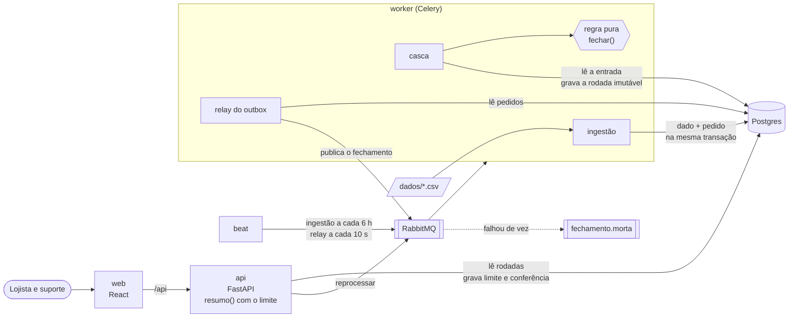

# Decisões

## Quem usa, e qual trabalho essa pessoa termina

Quem usa é a dona ou o dono de uma pequena empresa que faz o próprio fechamento. Vende por mais de uma adquirente e recebe tudo numa conta só. Não sabe o que é MDR, mas sabe quanto tinha que cair. Contratou a sinkfi para parar de conferir o extrato linha a linha. O trabalho que termina é o fechamento do período: saber o que pode fechar e o que está faltando de verdade. A Marina é o exemplo do enunciado: duas lojas, Stone e PagSeguro liquidando na mesma conta do Inter, fechamento toda segunda à noite.

O suporte pediu um dashboard de divergências com gráficos, e eu li o pedido como sintoma. O Rafa conta que quem fica reabrindo a tela de divergência cancela, e um cliente voltou para a planilha porque "pelo menos lá eu entendo". Listar melhor o que não bate não resolve isso; o que resolve é dizer o que cada coisa significa e o que fazer com ela. Por isso a tela abre com a resposta, "posso fechar?" e "o que falta de verdade?", e logo abaixo vêm as pendências, separadas em falta de verdade e para conferir. Cada pendência tem uma página própria: por que a regra a marcou, a linha do tempo da venda até o corte, o recebível e o crédito envolvidos, e o próximo passo provável, como conferir a liquidação no portal da adquirente, pedir o detalhamento de um repasse ou abrir um chamado com o NSU e a data prevista. A pendência deixa de ser uma linha vermelha e vira uma tarefa.

O suporte também usa o produto, para atender um chamado: acha o cliente por e-mail, CNPJ ou nome, que é o que chega no chamado, porque o id interno ninguém conhece (ADR 0010). Abre o fechamento, vê o mesmo relatório que a lojista viu e pode pedir um reprocessamento. Não muda o limite da trava nem marca a conferência no lugar dela (ADR 0005).

## O que entrou e o que ficou de fora

**Entrou** o fechamento inteiro, do jeito que a lojista usa: ela abre a tela e vê se pode fechar e quanto falta de verdade, a semana dia a dia, as pendências separadas por severidade, o motivo e o próximo passo de cada uma. Vê até quando os números valem, com a última atualização dos dados e a próxima prevista (ADR 0011). Define o próprio limite da trava, volta a fechamentos anteriores e marca o fechamento como conferido quando acaba. Por baixo está o caminho de uma aplicação real, que sobe com `docker compose up`: ingestão, fila, rodadas que não mudam depois de gravadas e login com papéis separados para lojista e suporte.

**Ficou de fora, por decisão**, o que atrapalha o trabalho dela:

- A página de dashboard antes do fechamento: seria um clique a mais. Os gráficos pedidos pelo suporte entraram, mas dentro do fechamento.
- Um botão que tranca o período: o relatório informa, quem decide é ela (ADR 0003).

**Com mais tempo**, entraria:

- O webhook `recebivel.liquidado`, para o ERP do cliente dar baixa sozinho no que casou certo (ADR 0008, issue #30).
- O bloqueio progressivo da conta depois de tentativas de login erradas.
- A evolução semana a semana.
- O fechamento mensal ou quinzenal.
- Uma tela de operação para o suporte, com o que a `/operacao` devolve. Hoje ela só se lê pela API.

## A regra de fechamento

> O que estava previsto para cair até o dia do fechamento e foi confirmado na conta até as 18:00 está fechado; o que caiu depois entra no fechamento seguinte; e só é falta de verdade o dinheiro que não entrou, ou que entrou e não é seu.

- Dinheiro a mais que não é de venda, como um Pix de terceiro, fica **para conferir**: vale olhar, mas não muda o fechamento.
- Quando um crédito sem o código da venda serve para mais de uma venda, a regra não escolhe: mostra as vendas juntas e quanto falta no grupo (ADR 0002).
- O relatório informa, não bloqueia. Quem fecha é a lojista, e ela sabe coisas que os dados ainda não mostram: pode ter resolvido uma pendência com a adquirente e não precisa esperar o próximo lote para fechar. Bloquear também exigiria uma política de materialidade que ninguém definiu, e inventá-la seria decidir por ela. Por isso a trava é opcional: ela define um limite, e o resumo recomenda não fechar quando a soma das faltas de verdade passa dele (ADR 0003).

## O que eu perguntaria para a Marina amanhã

1. **Depois que a tela diz "pode fechar", o que você ainda confere na mão?** Se ela ainda abre o extrato, a aposta não pagou, e a resposta mostra o que falta.
2. **Das pendências da semana, quais você resolveu sozinha com o próximo passo da tela, e quais virariam chamado?** Diz se a pendência virou tarefa ou continua sendo uma linha vermelha.
3. **Por que o fechamento é na segunda? O contador pede o mês fechado?** O fechamento é semanal, e o mensal ou quinzenal ficou de fora. Se o ritmo de segunda é só quando sobra tempo e quem recebe pede o mês, o próximo passo é deixar ela escolher o período.
4. **Para onde vai o fechamento depois que você termina: planilha, contador, sistema da loja?** A resposta escolhe o próximo passo. Se alguém redigita o que casou num sistema, é o webhook para o ERP (ADR 0008). Se vai para o contador ou para uma planilha, é o fechamento em PDF ou num arquivo estruturado. Nos dois casos, não é mais uma tela.
5. **Quanto tempo levava o fechamento de segunda antes, e quanto levou com a tela?** É a medida mais direta de que o trabalho ficou menor, e a base do sinal em Monitorar.
6. **Quando a tela diz "falta de verdade", "para conferir" e "próximo fechamento", o que você entende por cada um?** São nomes que nós escolhemos. Se ela lê algum de outro jeito, a tela informa errado mesmo com o número certo, e foi por não entender que um cliente voltou para a planilha.

## Desenho

O dado entra pela ingestão, que grava junto o pedido de fechamento. O relay publica esse pedido na fila, o worker roda a regra e grava a rodada, e a `api` só lê o que já foi calculado.

**Peças.** Seis serviços no Docker Compose: `web` (React) mostra o fechamento; `api` (FastAPI) faz o login, lê as rodadas e grava o limite, a conferência e o pedido de reprocessamento; `beat` dispara a ingestão de cada cliente a cada 6 horas; `worker` (Celery) roda a regra; RabbitMQ entrega os pedidos; Postgres guarda tudo. A ingestão grava o dado e o pedido de fechamento na mesma transação. Uma tarefa periódica publica os pedidos na fila, e o worker roda a regra e grava uma rodada que não muda mais (ADR 0004). Se a publicação falha, o dado não fica no banco sem o pedido de recalcular. Na dead letter, `fechamento.morta`, só cai o que falhou de verdade: o pedido repetido devolve a rodada que já existe, por causa de uma trava por cliente, e a tarefa que trava ou derruba o processo termina ali em vez de voltar sem fim.

**Onde a regra mora.** Em `backend/src/fechamento/`, como funções puras: `fechar(recebíveis, lançamentos, lojas, corte)` devolve os grupos e as pendências, e `resumo(pendências, limite)` devolve a recomendação. Não leem banco, fila, relógio nem arquivo, então são testadas em milissegundos, inclusive contra os CSVs reais. Em volta fica uma casca que carrega a entrada, chama a regra e grava o resultado; a casca depende do núcleo, nunca o contrário. O corte é entrada da regra: cada cliente tem seu dia e hora, e um fechamento continua recebendo rodadas até o corte seguinte, para pegar o crédito que o banco entregou atrasado.

**O que fica gravado.** Recebíveis e lançamentos ficam em tabelas que a ingestão atualiza, com as duplicatas do Open Finance, porque juntar é trabalho da regra. Cada rodada guarda uma cópia do que cada item usou, e o hash cobre a entrada, o corte e a versão da regra. Assim dá para explicar um número antigo exatamente como a lojista o viu, e uma correção na regra gera uma rodada nova em vez de devolver a errada (ADR 0006). O limite da trava é preferência dela, não dado do fechamento: fica fora da rodada. A conferência grava quem, quando, qual rodada, o limite e o resumo daquele momento.

**Trade-offs que aceitei.**

- *Mais peças do que o problema pede.* Um fechamento é um cálculo de milissegundos por cliente por semana; a regra chamada pela rota bastaria. A fila e o outbox entraram pelas garantias de produção (retry, dead letter, trabalho fora da requisição), ao custo de seis serviços para subir e entender. O plano de corte é chamar a mesma função de forma síncrona.
- *Dados duplicados a cada rodada.* É o preço de a rodada antiga nunca mudar. O modelo mais limpo seria versionar recebíveis e lançamentos, mas isso mudaria a ingestão inteira.
- *A ingestão não apaga.* Ela atualiza cada linha pelo `id`, então uma linha que some do CSV continua no banco. Aceitei porque a fonte corrige com um evento novo, como um estorno ou um chargeback, e não apagando a linha. Se uma fonte passar a remover linhas, a ingestão precisa comparar o lote inteiro e marcar o que sumiu.
- *Dois serviços, um contrato.* Os tipos do `web` são gerados do OpenAPI da `api`, e a CI falha se divergirem.

**Limites conhecidos da regra.**

- Crédito sem NSU só casa por adquirente e valor se cair entre um dia antes e quatro dias depois da data prevista. Fora disso, vira pendência.
- Na chave fraca, empates em que os candidatos só se sobrepõem em parte continuam resolvidos de forma gulosa.
- Um chargeback lançado depois do corte seguinte não volta ao fechamento do crédito que desfez.
- Um crédito sem venda que cai depois das 18:00 entra como "para conferir" neste fechamento, não no próximo.

## Monitorar

**O fechamento rodou.** Toda ingestão deixa um pedido de fechamento no Postgres, e todo pedido deve virar uma rodada para aquele cliente e corte. O alarme é uma mensagem em `fechamento.morta`: um fechamento que não rodou. O da semana atual volta na próxima ingestão, até 6 horas depois; o de um corte antigo só volta com um reprocessamento pelo suporte. Como só cai ali o que falhou de verdade (ver Desenho), uma mensagem na dead letter nunca é ruído. O beat parado não deixa pedido pendente nem mensagem na fila morta, por isso também conto os clientes sem ingestão há mais de 12 horas.

**Ela conferiu.** O botão "Marcar como conferido" registra quem, quando e qual rodada ela viu, sem travar nada. Ele se chamava "Terminei", mas o nome soava como fechar o período e não dizia o que fica gravado, por isso virou conferência em tudo, da tela à tabela (ADR 0012). Toda terça de manhã olho os números de uso da tabela abaixo.

**O valor da trava.** A trava vem desligada, porque ninguém definiu a partir de qual diferença não se fecha. Em vez de perguntar, olho o que quem ligou a trava gravou: a conferência guarda o limite daquele momento. A mediana, em percentual do total do fechamento, vira o valor padrão para quem nunca mexeu no limite. Em reais, a média misturaria lojas de tamanhos diferentes. E se quase ninguém liga a trava, ela não é a resposta.

**O que muda antes do chamado.** O chamado começa quando o número não convence, e isso aparece antes no uso: ela confere de novo na mesma semana; uma rodada nova muda um fechamento que ela já tinha conferido (o crédito de sexta que só aparece no domingo), e a tela avisa o que mudou, mas só quando ela abre; um fechamento anterior fica com pendência e sem conferência, e a tela lembra na semana seguinte. Nos três casos, o suporte pode olhar antes de ela escrever.

**As métricas.** Três perguntas, cada uma com seus números: se o trabalho dela ficou menor, se o fechamento rodou e se as peças estão de pé.

*Uso: o trabalho dela ficou menor.*

| Métrica | O que indica | Onde se mede hoje | Sinal |
|---|---|---|---|
| Clientes que conferiram na semana | Ela fecha pela tela | Consulta nas tabelas | Queda |
| Conferências de uma rodada que depois mudou | Ela conferiu um número velho | Consulta nas tabelas | Qualquer uma: o suporte escreve antes |
| Clientes que conferiram mais de uma vez na semana | O número não convenceu | Consulta nas tabelas | Chamado a caminho |
| Parcela do valor que a regra casou sem pendência, por adquirente | A regra resolve, ou a chave fraca virou o gargalo (ver Evoluir) | Consulta nas rodadas | Queda numa adquirente |
| Clientes com a trava ligada e mediana do limite em % | O valor padrão da trava | Consulta nas conferências | Quase ninguém liga |
| Vezes que ela reabre a mesma pendência | Quem fica reabrindo cancela | Não registrado | — |

*Operação: o fechamento rodou.*

| Métrica | O que indica | Onde se mede hoje | Sinal |
|---|---|---|---|
| Mensagens em `fechamento.morta` | Um fechamento que não rodou | `/operacao` | Qualquer uma |
| Pedidos pendentes e idade do mais antigo | A publicação ou o RabbitMQ parou | `/operacao` | Idade passando de minutos |
| Clientes sem ingestão há mais de 12 horas | O beat parou, ou a fonte não respondeu | `/operacao` (ADR 0011) | Qualquer um |
| Cliente com ingestão nova e sem rodada nova | O worker não está consumindo | Consulta nas tabelas | Qualquer um |
| `limite duro:` no log | Uma tarefa travou e foi morta | Log do worker | Qualquer um |

*Infraestrutura: as peças estão de pé.*

| Métrica | Onde se mede hoje |
|---|---|
| Postgres e broker respondem | `/api/health` |
| Mensagens na fila principal e consumers ativos | Painel do RabbitMQ, sem alerta |
| Taxa de 5xx e latência da API | Com mais tempo |
| Duração e tentativas da tarefa do worker | Com mais tempo |
| Disco e conexões do Postgres | Com mais tempo |

**Onde olhar e o que falta.** A `/operacao`, só do suporte, ainda não tem tela: quem consulta é o suporte ou a engenharia, pelo `/api/docs`. As mensagens na dead letter vêm `null` quando o RabbitMQ não responde ou recusa o login. O `/api/health` responde sem login. Cada falha definitiva sai no log do worker como `dead letter:`, com a tarefa, o cliente, o corte e o erro, inclusive o processo que morreu depois de acabarem as tentativas. A tarefa que passa do limite duro é morta e confirmada: não chega à fila morta e sai como `limite duro:`. Com mais tempo, poria a `/operacao` numa tela do suporte, passaria os logs para JSON, levaria as contagens para o Prometheus com um alerta na dead letter e gravaria quantas vezes ela abre a mesma pendência. O Rafa disse que quem fica reabrindo a tela cancela, e esse é o único sinal que ainda não registramos.

## Debugar

Esta seção é para o time técnico de plantão. O passo a passo, com os comandos, está em `docs/debugar.md`.

**O caminho.** *Qual rodada ela viu:* como suporte, abro o fechamento dela. A conferência diz qual rodada ela conferiu. Se o fechamento mudou depois, a tela mostra o resumo de antes e o de agora, e a primeira pergunta é se a diferença vem dessa mudança. *Qual item:* a página da pendência traz o motivo, ou a chave pela qual casou, a linha do tempo e o NSU. *O que a regra viu:* `GET /clientes/{id}/rodadas?nsu=` lista as rodadas em que a venda aparece. `GET /clientes/{id}/rodadas/{rodada}` devolve uma rodada antiga no formato do fechamento, com a cópia do recebível e do lançamento que a regra usou (ADR 0006). *A regra de hoje decide igual:* `python -m sinkfi.reproduzir` só lê. Ele diz se a versão da regra mudou, se a entrada mudou e o quê, e se a regra de hoje decide igual com a mesma entrada. Na demonstração, a rodada 1 mostra o `ext_14` passando de `confirmed` para `pending` depois de uma correção na ingestão. *Por quê:* a regra é uma função pura, então o caso vira um teste com os valores copiados da rodada. Ele roda em milissegundos e fica como teste de regressão.

**O que deixa outra pessoa fazer isso sem mim:** o runbook, as duas rotas, o script, o log de cada rodada (nova ou existente) e da dead letter, o `GLOSSARY.md` com o motivo de cada pendência e as ADRs.

**O limite.** Quem não programa vai até a página do item. A busca por NSU ainda é uma rota no `/api/docs`, não uma tela.

## Responder

**O fechamento não rodou.** Isso acontece de dois jeitos. No barulhento, o sinal é uma mensagem na dead letter ou pedidos pendentes envelhecendo na `/operacao`. Hoje não há alerta: alguém precisa olhar. Na primeira hora, o log `dead letter:` diz a tarefa, o cliente, o corte e o erro. Se a causa foi passageira, como o Postgres fora por mais de 13 minutos, que esgota as tentativas, o fechamento da semana volta sozinho na ingestão seguinte, e um corte antigo volta com um reprocessamento pelo suporte. Se é bug, a correção sobe e o suporte reprocessa. No silencioso, o beat para: nada falha, nada fica pendente, e só o `ultima_ingestao_em` parado e a lista `clientes_com_ingestao_atrasada` na `/operacao` mostram o problema. A resposta é subir o beat de novo; a ingestão seguinte, até 6 horas depois, traz os dados e recalcula o fechamento.

**Saiu um número errado.** A rodada errada não é apagada nem corrigida no lugar: ela continua mostrando o que a lojista viu. O caminho de Debugar separa erro no dado de erro na regra. Corrigida a regra, a versão nova entra no hash, e o reprocessamento gera uma rodada nova em vez de devolver a antiga (ADR 0006).

**Como a Marina fica sabendo.** Se ela já tinha conferido, a tela avisa "O fechamento mudou desde a última conferência" e mostra o antes e o agora, mas só quando ela abre. Por isso o suporte usa o registro da conferência para achar quem conferiu a rodada errada e escreve antes, dizendo o que mudou e se a decisão de fechar muda.

**O que impede de novo.** O caso vira um teste da regra com os valores reais, e a CI não deixa a regressão voltar.

## Evoluir

**Se a aposta estiver certa,** a lojista fecha pela tela sem abrir o extrato, e os chamados de "o número não bate" caem. Aí o gargalo passa a ser a chave fraca: cada crédito sem NSU que vira grupo é uma pendência que a regra poderia ter resolvido. A próxima mudança é uma chave mais forte: o relatório de pagamentos da adquirente, que diz quais vendas compõem cada repasse, e o código de estabelecimento por loja. Antes de construir, perguntaria à Stone e ao PagSeguro se mandam esse relatório, se cada loja tem código próprio e se a agenda atualiza a data prevista na antecipação. Para o cliente com ERP, o passo seguinte é o webhook `recebivel.liquidado` (ADR 0008), que fica de fora até alguém pedir.

**O que me faria desfazer a aposta.** As perguntas para a Marina são o teste. Se ela ainda confere na mão depois do "pode fechar", ou se os chamados de divergência não caem, a tela de resposta não resolveu, e o pedido original do suporte volta à mesa. Se ela entende "para conferir" ou "falta de verdade" de outro jeito, o problema é de linguagem antes de ser de regra.

**Escala.** O acesso ao banco é síncrono, na api e no worker, porque a api só faz consultas curtas sobre rodadas já calculadas e o trabalho pesado roda fora da requisição. Para atender mais gente, sobem mais cópias da api com um pool de conexões na frente do Postgres. Eu trocaria para assíncrono se a api passasse a esperar um serviço externo lento dentro da requisição, como consultar o Open Finance na hora; o sinal seria o tempo de resposta subir com as threads todas ocupadas e o banco ocioso.

## Como cheguei aqui

Li o enunciado inteiro antes de abrir os dados. O suporte pedia um dashboard, mas o trabalho da Marina é fechar a segunda à noite, e essa leitura guiou o resto.

Depois fui conhecer os dados. Pedi ao Claude uma análise da amostra (`analise/ANALISE-DADOS.md`) para saber com que tipo de dado eu estava lidando, sabendo que em produção apareceriam casos que a amostra não tem. A prática que sigo é esta: se dá para ver todos os dados, ótimo; se não dá, tiro uma amostra de produção, anonimizada e estratificada por cliente, e busco direto os casos raros, que uma amostra aleatória não pega.

Com a amostra em mãos, decidi as regras antes de escrever código. Cada decisão saiu com o porquê e o nome do teste que a garante. As que têm trade-off viraram ADR em `docs/adr/`, e os termos foram para o `GLOSSARY.md`.

O repositório inteiro foi feito com TDD, desde a primeira feature. O primeiro PR de código já trouxe a regra pura, o primeiro teste e a CI no GitHub Actions. A partir daí, cada mudança entrou sobre uma base que eu sabia estável, e um PR com teste quebrado não passa.

Para trabalhar com agentes sem deixar de ser dono das decisões, usei o pacote de skills do Matt Pocock (`mattpocock/skills`), configurado no repositório em `CLAUDE.md` e `docs/agents/`. Ele divide o trabalho em etapas: grilling para testar cada decisão antes de codar, modelagem de domínio para os ADRs e o glossário, um mapa de issues no GitHub com as fatias de construção, TDD na implementação e code review no fim. O agente propõe e executa; quem decide sou eu.

A ordem de construção seguiu o risco. Primeiro a regra, que é onde o número pode sair errado. Depois vieram o banco e a ingestão, a API e a tela, o login, a fila e o outbox. Quando a revisão achava um erro, o teste vermelho vinha antes da correção.

## Como usei IA

Usei IA como tutor e para ganhar velocidade. As decisões são minhas, e o `CLAUDE.md` fica no repositório de propósito. Conferi o que ela calculou, como a soma de conferência da análise, e discordei quando a proposta não fechava. Ela sugeriu escolher a menor parcela no empate da chave fraca, o que contradiz o resultado por grupo, e a regra passou a mostrar a dúvida. Recomendou um serviço só em TypeScript, como se o produto servisse uma pessoa; virou Python no back e React no front. Superestimou o custo do outbox e das ferramentas de debugar, e as estimativas caíram quando cobrei o número. No fim, um code review por dois eixos achou dois erros que os 163 testes não pegavam: o log no limite duro e o texto do processo morto. As duas correções saíram da leitura do código do Celery 5.7, sem reproduzir num worker real.
