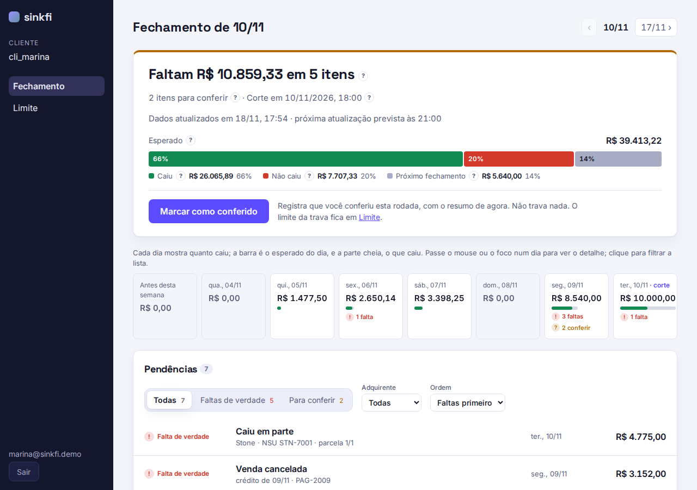
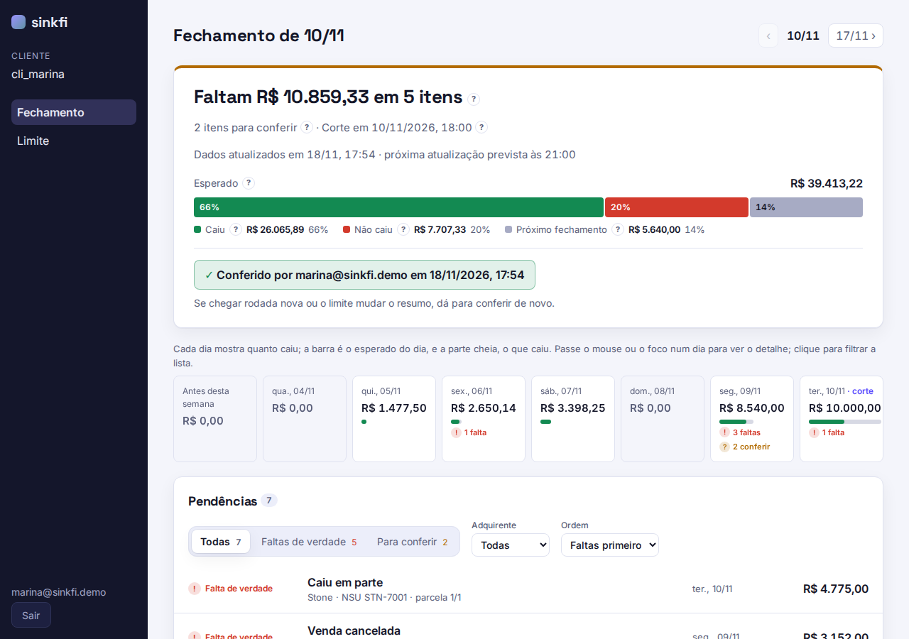
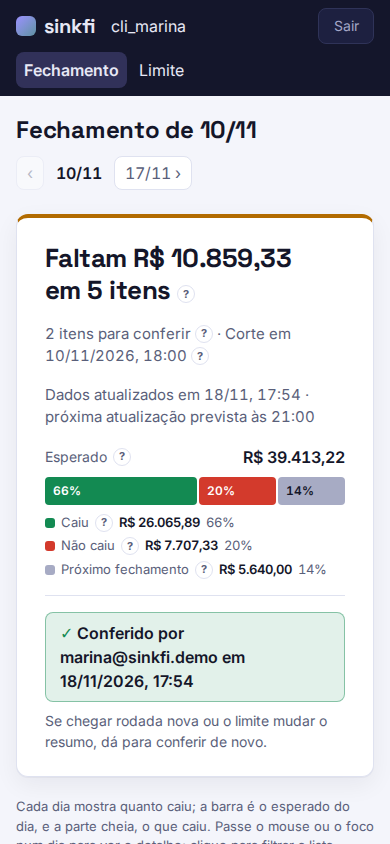
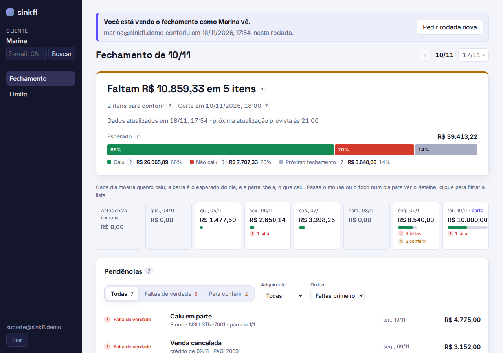

# sinkfi: o fechamento da segunda

A Marina abre a tela na segunda à noite e vê quanto faltou cair na conta, em quais itens, e o que ainda precisa conferir. O suporte vê o mesmo fechamento que ela.

- O desafio está em [`ENUNCIADO.md`](ENUNCIADO.md).
- As escolhas de produto e o desenho estão em [`DECISOES.md`](DECISOES.md).

## Como chegar

Precisa de Docker com Compose. Na raiz do repositório:

```sh
docker compose up -d --build --wait
```

Abra http://localhost:8080. Se a porta estiver ocupada, use `WEB_PORT=8088 docker compose up -d --build --wait`.

Na primeira subida, o `semear` cria a Marina, ingere os CSVs de `dados/` e roda o fechamento de 10/11. Rodar de novo não repete nada.

A porta escuta só em `127.0.0.1` (ADR 0013). Para abrir de outra máquina, use um túnel: `ssh -L 8080:localhost:8080 <servidor>`.

| Entrar como | E-mail | Senha |
| --- | --- | --- |
| Lojista, a Marina | `marina@sinkfi.demo` | `marina-demo` |
| Suporte | `suporte@sinkfi.demo` | `suporte-demo` |

As senhas só valem para a demonstração. A lojista cai direto no fechamento dela. O suporte acha a cliente pela busca, por e-mail, CNPJ ou nome (ADR 0010). Tente `marina`.

| | Computador | Celular (390 px) |
| --- | --- | --- |
| A lojista vê quanto faltou e quando os dados chegaram |  |  |
| Ela marca a rodada como conferida, o que não trava nada (ADR 0012) |  |  |
| A conferência fica registrada com quem conferiu e quando |  |  |
| O suporte vê o que a Marina vê e quando ela conferiu |  |  |

## O que testar

Como a Marina:

- **O resumo.** Pode fechar? Quanto falta de verdade? Cada "?" explica o termo. Logo abaixo vêm quando os dados chegaram e quando chega a próxima atualização (ADR 0011).
- **A semana dia a dia.** Passe o mouse ou o foco num dia para ver o detalhe; clique para filtrar a lista.
- **As pendências.** Filtre por severidade, adquirente e ordem. Abra uma pendência para ver por que a regra a marcou, o recebível e o crédito, e o que fazer.
- **Resolver uma pendência para conferir.** Abra uma "Entrada sem recebível" e use "Marcar como resolvida", com uma nota. Ela sai das contagens, vai para "Resolvidas" e pode ser desfeita (ADR 0014).
- **A trava.** Em Limite, um valor abaixo das faltas, como `5000`, faz o resumo dizer "Não feche". Vazio, a trava fica desligada (ADR 0003).
- **Conferir.** "Marcar como conferido" registra quem conferiu, quando e com qual resumo (ADR 0012). Se o resumo mudar depois, por exemplo ao resolver uma pendência, mudar o limite ou chegar uma rodada nova, a tela mostra o antes e o agora.
- **Outras semanas.** Use as setas ao lado da data. Uma semana marcada como "não calculado" é calculada quando você abre (ADR 0007).

Como suporte:

- **Achar a cliente.** Busque por `marina`, pelo e-mail ou pelo CNPJ (ADR 0010).
- **Ver o que ela vê.** O suporte vê a mesma tela, com uma faixa que diz quem conferiu e em qual rodada. "Pedir rodada nova" recalcula o fechamento aberto. Mudar o limite e conferir são só da lojista (ADR 0005).
- **A operação.** `/api/docs` e `GET /operacao`, em [Saúde e operação](#saúde-e-operação).

O aviso de fechamento anterior com pendência e sem conferência (ADR 0007) só aparece quando há mais de uma semana com dados. Para vê-lo, use os lotes de teste abaixo.

## Testar com outros dados

A ingestão lê `dados/`: `lojas.csv`, `recebiveis.csv` e `extrato.csv`, com as mesmas colunas de hoje.

- **Mudar linhas com a stack de pé.** Edite os CSVs e peça a ingestão na hora:

  ```sh
  docker compose exec worker celery -A sinkfi.tarefas call sinkfi.agendar_ingestoes
  ```

  Em uns 20 segundos, a tela mostra uma rodada nova, depois de recarregar. Sem esse comando, o `beat` ingere às 0, 6, 12 e 18h UTC.
- **Trocar o conjunto inteiro.** A ingestão sobrescreve a linha pela chave da fonte (`cliente_id` e `id`, mais a adquirente no recebível; ADR 0009), mas não apaga: uma linha tirada do CSV continua no banco. Para começar de um conjunto novo, apague o banco com `docker compose down -v` e suba de novo.
- **Outras datas.** Os cortes andam de 7 em 7 dias a partir de 10/11 às 18:00, a data com que os CSVs do desafio batem (ADR 0007). Dados de outra semana caem nesses cortes, e a tela navega entre elas. Se o corte for em outro dia ou hora, troque a âncora, por exemplo `SINKFI_ANCORA_DOS_CORTES=2026-11-16T18:00:00-03:00 docker compose up -d --wait`. Com ela vazia, vale o dia de fechamento do cliente.
- **Lotes de teste prontos (opcional).** [`dados-teste/`](dados-teste/LEIA.md) traz dois lotes com mais casos: a semana de 03/11, a de 17/11 e, no lote 2, o que chega depois. A aplicação não lê essa pasta: ela só lê os três nomes fixos de `dados/`. Para usar um lote, copie os arquivos por cima e comece do zero:

  ```sh
  cp dados-teste/lote1/*.csv dados/   # PowerShell: Copy-Item dados-teste\lote1\*.csv dados\ -Force
  docker compose down -v
  docker compose up -d --build --wait
  ```

  Com a stack de pé, dá para copiar e pedir a ingestão na hora, com o comando do primeiro item. O lote 2 contém o lote 1, então o caminho sugerido é: lote 1, ingestão, conferir na tela; depois lote 2, ingestão, e ver o que mudou desde a última conferência. Para voltar à demonstração padrão: `git checkout -- dados`, `docker compose down -v` e subir de novo. Os casos e os números esperados estão em [`dados-teste/LEIA.md`](dados-teste/LEIA.md). Não abra os CSVs no Excel: ele grava BOM e `;`, e a ingestão cai na dead letter.

  O fechamento "atual" é o último corte que já passou, então a semana de 17/11 deixa de ser a atual em datas posteriores; as outras continuam na navegação.

O `backend/README.md` tem mais detalhes sobre a fila, o worker e a dead letter.

## Saúde e operação

O `/api/health` não pede login e diz se a api fala com o Postgres e com o broker. O `GET /operacao` mostra a fila, a dead letter e as ingestões atrasadas. Ele é feito pelo `/api/docs`, logado como suporte. O roteiro de plantão está em [`docs/debugar.md`](docs/debugar.md), seção 6.

## Onde está cada coisa

| O quê | Onde |
| --- | --- |
| Escolhas de produto e desenho | [`DECISOES.md`](DECISOES.md) |
| Decisões com contexto e alternativas | [`docs/adr/`](docs/adr/) (0001 a 0014) |
| Roteiro de "o número não bate" | [`docs/debugar.md`](docs/debugar.md) |
| Vocabulário do domínio | [`GLOSSARY.md`](GLOSSARY.md) |
| Leitura dos dados da semana | [`analise/ANALISE-DADOS.md`](analise/ANALISE-DADOS.md) |
| A regra do fechamento, pura | `backend/src/fechamento/` |
| Api, fila e banco | `backend/src/sinkfi/` ([`backend/README.md`](backend/README.md)) |
| A tela | `web/` ([`web/README.md`](web/README.md)) |

## Testes

```sh
cd backend && uv run pytest   # os de integração sobem Postgres e RabbitMQ com Docker
cd web && npm ci && npm test
```

A CI ([`.github/workflows/ci.yml`](.github/workflows/ci.yml)) roda os dois e o build. Ela também confere se os tipos da tela batem com o OpenAPI da api.
